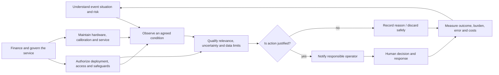

# Siamese Embedded — Ex-Ante Business-Model Activity-System Exploration

**Status:** v0.1 / 20 November 2026 / prospective and falsifiable; business architectures have not been validated.  
**Method:** ESSEC Croque Gourmet *pre-case activity-system exploration*, drawing on Zott & Amit (2010), the nine-block Business Model Canvas, and hypothesis-driven Lean discovery. **This method is transferred to a new case; the alternatives and hypotheses below are our new exploratory proposals, not claims made by Zott & Amit.**

> **Source-fidelity rule:** Begin with the underlying user outcome and market activities *without* assuming a camera, facial identification, a radio link, or a hardware sale. The existing research device, 1:N matcher, radio alarms and engineering work are *possible responses*, not evidence of a market need. No protected biometric Study 1B scores are used.

## Step 1. Neutral value-producing function — define the job before technology

**Candidate neutral job:** *Help authorized people responsible for a temporary event detect and respond to material entrance/flow conditions promptly, with acceptable human workload, total cost and legal safeguards.*

This is deliberately more general than "identify people using an edge watchlist." The latter is a particular technical hypothesis, not an accepted customer job. Other independently testable jobs may be: (a) evidence-based risk/quality testing for embedded biometrics without deployment, or (b) reducing the integration burden of low-power remote sensing and secure alerts for OEMs.

The hypothesis of market existence is open. The actual buyer, user, site authorizer and beneficiary may differ.

## Step 2. Actors, economic incentives, decision rights and veto points

| Actor | Possible activity or capability | Receives value | Pays / authorizes / can block |
|---|---|---|---|
| Event organizer / operator | define operational pain, finance event workflow | fewer disruptions, faster triage | may buy, but may not authorize invasive data processing alone |
| Contract security company / shift operator | human incident review, dispatch and response | fewer irrelevant alerts, traceability | labor owner, can reject excessive false alerts |
| Venue / landlord / event infrastructure owner | mount access, power, connectivity and installation | safety and compatible installations | physical veto on mounting and power |
| Attendees / affected people | transit site; potential data subjects | safety, accessibility and privacy | rights, procedural protection; not assumed consent |
| DPO, legal counsel, competent authority | assess legal basis, security, proportionality | reduced harm/compliance risk | hard veto on unlawful biometric scenarios |
| Hardware integrator / OEM | combine sensors, enclosures, gateway and service | differentiation and integration savings | buyer or licensee; product-interface authority |
| Independent testing lab / research sponsor | run metrology and validation | reproducible scientific evidence | contracts/funds and method gate |
| Technology supplier | silicon, cameras, firmware, radio | component margin / IP revenue | licenses, availability and integration dependencies |
| Insurance / certification / finance partner | risk coverage, conformance or capital | reduced exposure | possible scale/cost blocker |

## Step 3. Generic activity graph (before allocating any technology)

**Activities, not product features:** these nodes are the causal work required to create value. A human-only process, an existing access-control system, a non-identifying sensor, an operated service and a local 1:N research prototype may instantiate the graph differently. The graph helps expose whether the bottleneck is sensing, triage, staff action, authorization or integration. We must test which activity actually constrains system value.

## Step 4. Morphological exploration — vary content, structure and governance

Do not score architectures until their *activity-system differences* are explicit.

| ID / architecture | CONTENT: what is performed | STRUCTURE: how activities connect | GOVERNANCE: who owns/does/risks |
|---|---|---|---|
| **O0: non-digital/human or existing system baseline** | manual observation, incident calls, existing CCTV/radio/access practice | staff-led observe → review → act; current loops | organizer and incumbent security team |
| **O1: non-identifying signal device** | detect permitted passage/flow/equipment conditions; send sparse authenticated notifications | distributed edge nodes → event local dispatch; no identity | equipment supplier sells/rents to event integrator; organizer operates |
| **O2: managed edge assurance service** | site survey, setup, installation, monitoring, maintenance, incident workflow, post-event report | provider bundles activities into per-event outcome service | managed service company owns/redeploys units and carries SLA costs |
| **O3: voluntary consented 1:1 access service** | credential + on-site voluntary claimant verification and alternate human lane | person presents claim → local verification → access operator decision | credential issuer, venue and privacy-responsible controller split rights |
| **O4: OEM/licensing of edge low-power stack** | reference design, energy metrology, radio gateway/MCU firmware, support and validation kit | OEM integrates module → distributes within own products | OEM owns channel/hardware; venture licenses IP/engineering and supports integrators |
| **O5: independent verification/benchmark lab** | replay, calibrated energy/thermal/comparison studies, reproducible technical claims | independent test project → evidence report → engineering decisions | independent lab/research firm paid by manufacturer or sponsor |
| **O6: restricted-authority research project** | tightly authorized dataset/identification study with separate legal and scientific gates | formal authorization → controlled test → independent evaluation → decision | authorized institution governs legal mandate; independent scientific assessor |
 
The O0 baseline is intentionally an actual alternative, not a decorative option. O1–O6 are **not** all equivalent market paths or equally legally deployable. A civilian 1:N face watchlist at public events is not presumed admissible.

## Step 5. NICE themes — causal value hypotheses, not evidence

| Opportunity | Main candidate NICE mechanism | Precise unproven mechanism / counter-hypothesis |
|---|---|---|
| O1 | **Efficiency / Complementarities** | faster meaningful escalation + existing security radio yields less dispatcher effort; counter: false positives create more work than they save |
| O2 | **Complementarities / Efficiency** | provider reuses staff, devices and learning across events; counter: travel/setup/insurance/SLA costs destroy margin |
| O3 | **Novelty / Complementarities** | appropriate opt-in verification aligns identity claims with existing tickets; counter: conventional ticketing/1:1 is simpler and privacy burden remains |
| O4 | **Novelty / Lock-in** | integrators save power/firmware integration time; counter: commodity modules or standards erase advantage; avoid predatory lock-in |
| O5 | **Efficiency / Complementarities** | comparable calibrated evidence reduces engineering uncertainty and unnecessary builds; counter: buyers will not pay for independent research |
| O6 | **Novelty / Complementarities** | controlled research could answer a valid institutional question; counter: no legal mandate, poor sample representativity or no independent trial permission |
 
Where value actually flows (benefit owner), who captures it (payee), and who incurs risk (operator/affected people/controller) must be recorded separately. NICE lenses do not establish superiority; different activity-system structures can yield similar outputs.

## Step 6. Value capture, incentive compatibility and business model assumptions

| ID | Likely payment mechanism to TEST | Main cost/risk bearer | Principal governance dependency |
|---|---|---|---|
| O1 | equipment sale or per-event rental | supplier/integrator warranty and installation | usable workflow with site safety approval |
| O2 | per-event managed service with optional minimum | provider bears staff, travel, incident support | trusted subcontractor and SLA responsibilities |
| O3 | credential verification integration / transaction fee | integrator/controller compliance and access equity | lawful purpose and genuine alternative process |
| O4 | development NRE + reference design license + support | licensor engineering/support; OEM integration | ownership/IP/license and independent benchmark |
| O5 | paid scoped test/validation contract | lab instrumentation and scientific reputation | independence, evidence scope and data-use agreements |
| O6 | sponsored research contract with legal gate | authority sponsors; research team provides controlled evidence | statutory authorization, site control and independent review |

**Not verified:** price, willingness to pay, market size, recurring contracts, certification budget, marginal cost, OEM interest, scientific buyer demand, and claims of biometric performance.

## Step 7. Contradictory hypotheses and discriminating experiments

| Opportunity | Most dangerous hypothesis | Rival explanation | Cheapest high-information experiment | Prespecified STOP/PIVOT signal |
|---|---|---|---|---|
| O0 | current process is materially deficient | current radio/human teams already respond well | walk-through with organizer and operator, incident-log reconstruction | if delays/losses are not economically important, stop searching for new detection hardware |
| O1 | signal reduces meaningful response burden | alerting increases noise | tabletop dispatch with scripted synthetic events versus O0; observe false alert handling | no reduction in staff workload or high nuisance rate -> pivot/stop |
| O2 | customers value a managed outcome not components | integration costs are already sunk and provider sees thin margin | written priced per-event pilot offer and detailed install/operations cost walk-through | no funded partner or negative contribution -> pivot |
| O3 | verified credential resolves real unauthorized-access pain | scan-only tickets plus staff check suffice | service blueprint, mock opt-in UI and independent legal preassessment | no legally feasible use/consent or clear operator improvement -> stop |
| O4 | OEM's engineering cost of edge telemetry is high enough to license | simpler COTS and open firmware suffice | 4–6 OEM engineer interviews + integration time trial against commodity board | no integration advantage or no sponsor willing to scope NRE -> pivot |
| O5 | developers pay for credible energy/accuracy evidence | vendor benchmark meets their needs | paid design-partner proposal for bounded reproducibility audit | no scoped funded test or no data rights -> stop |
| O6 | a legitimate sponsor and legally enabled study exist | hypothetical exception is not authorization | independent written legal scoping + sponsor research question | **hard stop** without mandate/authorization; no test on real biometric data |

Cross-cutting hypothesis H-TECH: 512D→128D learned Siamese compression has sufficient **total system** J/event + memory/search advantage while retaining legitimate biometric thresholds vs raw/PCA. Test with frozen permitted data and independent external instrumentation. Do not move scientific protected Study 1B SCREEN/TEST.

Cross-cutting H-LEGAL: proposed data use and event setting are authorized. This is a **hard feasibility gate**, not a weighted cost in a business scorecard. A law-enforcement or defense context is not itself a general-purpose exemption.

Cross-cutting H-RF: short secure low-power radio improves dispatch reliability at acceptable energy, RF coexistence, and *human acknowledged* workflow; no assumption that network ACK is human action.

## Step 8. Frozen prospective comparison rubric and portfolio allocation

**Apply only after interviewing stakeholders and preserving counterevidence.** Consider (1) unmet need/materiality, (2) authority/legal feasibility, (3) buyer vs user incentive alignment, (4) control of necessary activities, (5) lowest-cost falsifying experiment, (6) repeatable economic contribution, (7) technological comparative advantage, (8) path to scale and value capture, (9) resilience/privacy. Label evidence `OBSERVED`, `REPORTED`, `TESTED`, `UNVERIFIED` and `BLOCKED` with supporting logs and permissions. Do not invent likelihood scores or weighted certainty.

**Initial discovery order is a portfolio decision, not a market result:** O1 and O5 can be researched in parallel using non-identifying/synthetic data. O4 can be explored via OEM interviews without custom PCB. O2 follows proof of operator burden and repeatability. O3 requires a defined voluntary authorization regime and comparison to existing access methods. O6 is barred from personal-data trials until a specific competent legal sponsor and independent authorizations exist. It is valid to stop all business routes while preserving technical research value.

## Step 9. Only now instantiate business-model Canvas and requirements

For **each** O1–O6, independently fill all nine BMC blocks with explicit `hypothesized / interviewed / contracted / experimentally validated` status: segments, value proposition, channels, customer relationship, revenue, resources, activities, partners, costs. Do **not** collapse them into a single combined O1/O5 canvas. Each Business Requirement must be linked to the selected architecture, its actors/activities and its own falsification experiment: `AS-ID -> H-ID -> experiment -> evidence -> decision -> BMC version -> BR -> CAP -> feature -> use case -> acceptance criterion -> run evidence`.

Existing preliminary requirements `business/BUSINESS_TO_VERIFICATION_TRACEABILITY_V0.csv` give the downstream BR→capability chain but **do not mean that the activity-system hypotheses have been validated**. Revise requirement scope after actual portfolio selection, not retroactively to rationalize the chosen board.

## How this relates to the ESSEC Croque Gourmet method

The source study *Croque_Gourmet_ESSEC_Document_complet_2026.docx*, preliminary framework (pp. 2–5), applies this exact sequencing: value function, actors, generic activity graph, morphological variation of content/structure/governance, NICE, incentives, rival hypotheses, frozen comparison rubric, then assessment of concrete alternatives. Its activity-system reasoning is **not** a UML Activity Diagram test-automation model; it is a cross-organizational economic/operational design lens. The diagrams above are original proposed analytical representations for this new case.

## Sources

- Zott, C. & Amit, R. (2010). *Business Model Design: An Activity System Perspective*, Long Range Planning. https://doi.org/10.1016/j.lrp.2009.07.004
- Zott, C., Amit, R. & Massa, L. (2011). *The Business Model: Recent Developments and Future Research*. https://doi.org/10.1177/0149206311406265
- Osterwalder, A. & Pigneur, Y. (2010). *Business Model Generation*. Wiley.
- March, J. G. (1991). *Exploration and Exploitation in Organizational Learning*. https://doi.org/10.1287/orsc.2.1.71
- ESSEC / Croque Gourmet original user-supplied working study (2026-11-07), preliminary methodology pp. 2–5.
- Existing Siamese business summary: `business/VENTURE_THESIS_AND_GATES_V0.md`.
- Technical mission: `hardware/FIXED_EVENT_INSTALLATION_MISSION.md`.
- Regulatory and scientific guardrails: `business/VENTURE_THESIS_AND_GATES_V0.md`.
